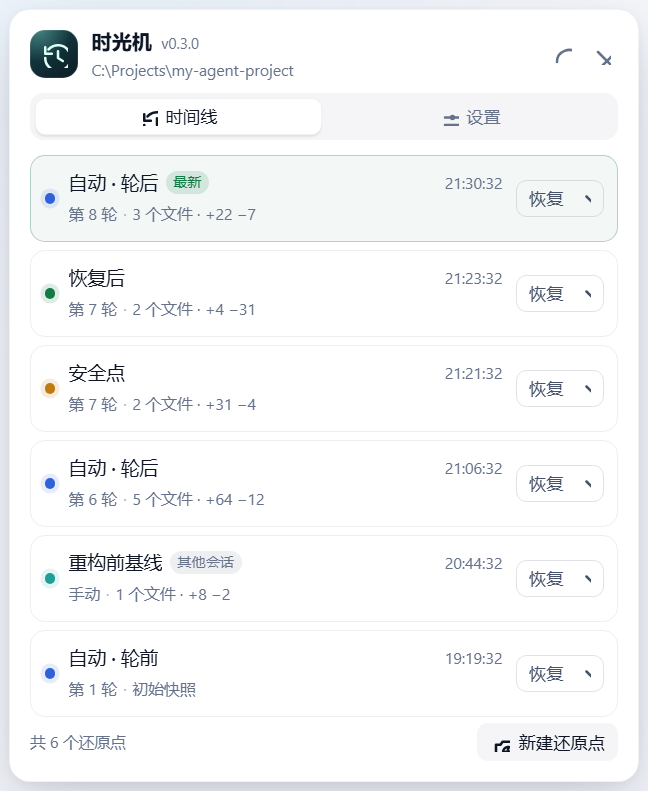

# 时光机 · dsh-time-machine

> 给 DeepSeek Harness 的每一次 Agent 改动装一根**倒车杆**。



DSH 已经能告诉你「这一轮改了哪些文件」。时光机补上后半句：**把文件退回去**。

它用一套私有影子 Git 仓库，在每个改变文件的轮次自动留下还原点；可以预览恢复影响、选择覆盖或精确恢复；恢复前自动再存一个安全点，恢复失败自动回滚；连回滚失败也留下可恢复的日志。

对话不倒退，文件可以。

---

## 目录

- [为什么是它](#为什么是它)
- [它能做什么](#它能做什么)
- [安装](#安装)
- [使用](#使用)
  - [会话标题栏面板](#会话标题栏面板)
  - [`/rewind` 命令](#rewind-命令)
  - [`time_machine` 工具](#time_machine-工具)
  - [CLI](#cli)
  - [HTTP 接口](#http-接口)
- [工作方式](#工作方式)
  - [影子仓库](#影子仓库)
  - [记录时机](#记录时机)
  - [恢复流程](#恢复流程)
  - [失败与恢复日志](#失败与恢复日志)
- [配置](#配置)
- [安全边界与已知限制](#安全边界与已知限制)
- [数据目录](#数据目录)
- [卸载](#卸载)
- [开发与验证](#开发与验证)
- [路线图](#路线图)
- [许可](#许可)

---

## 为什么是它

Agent 能连续执行几十次工具调用、改几十个文件。真正让人不敢放开手的不是「改错」，而是**改错之后只能手动收拾**：

- 编辑器有撤销，Git 有 `reset`，但 Agent 的改动横跨文件、混合了用户自己的编辑，还经常发生在你离开键盘的时候；
- 内置的「本轮改动」卡片能看 diff，但它是只读的；关掉会话后对比也消失；
- 让 Agent「再改回去」并不可靠：它可能忘、可能引入新问题，还可能把回滚本身也改坏。

时光机的立场很直接：**Agent 的每一次改动都应该是可逆的**。不是靠模型自觉，而是靠宿主侧一套独立、持久、可验证的快照与恢复机制。

它把协作契约从「信任 Agent，事后检查」变成「让 Agent 放手做，随时可退」。

## 它能做什么

- **逐轮自动还原点**：轮次开始/结束各记录一次，只在工作区真的变化时落一条记录。
- **持久**：影子仓库与元数据在 `$DSH_HOME/.dsh-time-machine`，重启 DSH 后仍然可选。
- **不碰用户仓库**：用自己的 Git 目录、index 与 refs；用户仓库的 index、objects、HEAD、分支、未提交改动都不动。
- **影响预览**：恢复前展示将写入/删除的文件、行数、示例路径与警告。
- **两种恢复**：
  - **覆盖恢复**：把还原点里的文件写回，不删除之后新增的文件；
  - **精确恢复**：同时删除还原点之后新增的文件；忽略文件永远不动。
- **安全点 + 自动回滚**：恢复前自动创建安全点；中途失败自动按安全点回滚。
- **持久恢复日志**：连回滚也失败时保留 journal，可在终端用 `dsh-time-machine recover` 再回滚。
- **多入口**：会话标题栏面板、`/rewind` 命令、`time_machine` 工具、CLI、同源 HTTP API。
- **工作区范围**：会话在 Git 仓库子目录时，只快照该子树；使用仓库根的 `.gitignore` 规则，但不触碰子目录外的文件。
- **零运行时依赖**：宿主侧只用 Node 内建模块；客户端只用宿主提供的 React。

## 安装

### 1. 安装到 profile

```powershell
cd path/to/dsh-time-machine

# 预览要改什么，不写盘
node scripts/install.mjs

# 确认后执行
node scripts/install.mjs --apply
```

脚本会：

1. 把插件复制到 `<profile>/node_modules/dsh-time-machine`；
2. 在 profile `package.json` 的 `dependencies` 写入 `file:<repo-root>`；
3. 把 `dsh-time-machine` 追加到 `dsh.profile.bundles`；
4. 写盘前把 profile 清单与已有插件副本备份到 `$DSH_HOME/dsh-time-machine-backup-<时间戳>/`，并生成 `restore.ps1`。

**完全退出并重启 DSH** 后宿主侧生效。客户端产物改完后可以只同步浏览器半边：

```powershell
node scripts/install.mjs --sync-client --apply
```

> 已安装副本是快照；改源码后需要重新安装（或只同步客户端）。`scripts/install.mjs --status` 会显示本地/已装版本与清单状态。

### 2. 前置条件

- DSH `>= 0.2.0-rc.2`；
- 宿主 `PATH` 上有可用的 `git`（`git --version` 能运行）；
- 建议 Git 2.13+（快照只使用常规 plumbing，无网络请求）。

没有 git 时插件仍会加载并给出明确错误，不会拖垮宿主。

## 使用

### 会话标题栏面板

在任意顶层会话的标题栏右侧会出现「时光机」按钮：

- **时间线**：按时间倒序列出还原点，标出自动/手动/安全点/恢复后、轮次、文件数与行数；其他会话的还原点会带标记。
- **恢复**：点某一行的「恢复」，选择：
  - **覆盖文件**：写回文件，不删除新增文件；
  - **精确还原**：写回文件并删除新增文件（需要勾选确认）。
  预览会展示写入/删除数量、行数、示例文件与警告；确认后执行。
- **新建还原点**：随时手动留点。
- **设置**：自动记录开关、轮前/轮后记录、保留数量与天数、快照/恢复超时、单文件上限、自动 GC、额外排除；修改后全局生效。
- 会话运行中恢复会被锁定（避免与 Agent 的写入竞争）；自动记录继续。

面板会显示最近 50 个还原点；更多可用 CLI 查看。

### `/rewind` 命令

命令直接作用于当前会话，不产生模型消息：

```text
/rewind                        列出最近 10 个还原点
/rewind snapshot [备注]        立即创建还原点
/rewind restore <id>           覆盖恢复（不删除新增文件）
/rewind restore <id> --exact   精确恢复（同时删除新增文件）
/rewind recover [planId]       查看/执行未完成恢复的回滚
```

恢复在会话空闲时执行；恢复前的安全点、恢复后的快照 id 会显示在结果里。命令输出只给用户看，**不会**自动注入模型上下文；继续工作前请让 Agent 重新读取已回滚的文件。

### `time_machine` 工具

模型可调用：

```json
{"action": "list"}
{"action": "snapshot", "label": "before refactor"}
{"action": "restore", "checkpointId": "20261025-142105-c3d4"}
```

- 工具描述要求模型**只在用户明确要求回滚时**调用 `restore`，不得自行决定；
- 工具恢复固定为「覆盖文件」模式，**不删除**新增文件；精确恢复只对人类入口开放；
- 工具恢复允许发生在它自己的轮次里（模型正等待工具结果，不会与其他写入重叠）；有其他会话在同一工作区运行时仍会拒绝；
- 每次恢复前都会创建安全点。

### CLI

CLI 与 DSH 使用同一个数据目录：

```bash
node lib/bin.js status
node lib/bin.js list --workspace D:/Projects/some-project
node lib/bin.js snapshot --workspace D:/Projects/some-project --label "before refactor"
node lib/bin.js restore --workspace D:/Projects/some-project --checkpoint 20261025-142105-c3d4 --mode overwrite
node lib/bin.js restore --workspace D:/Projects/some-project --checkpoint 20261025-142105-c3d4 --mode exact --yes
node lib/bin.js recover
node lib/bin.js gc --workspace D:/Projects/some-project
node lib/bin.js doctor
```

- `restore` 默认只打印计划；加 `--yes` 才执行。
- `recover` 无参数时列出未完成恢复日志；`--workspace <dir> --plan <id> --yes` 执行回滚。
- `doctor` 检查工作区记录、缺失快照对象、恢复日志、对象体积与陈旧临时索引。
- 数据目录覆盖：`DSH_TIME_MACHINE_DATA_DIR`；关闭自动记录：`DSH_TIME_MACHINE_DISABLE=1`。

### HTTP 接口

面板使用的同源接口（只接受回环请求；写操作带进程内控制密钥）：

| 方法 | 路径 | 作用 |
|---|---|---|
| GET | `/plugins/dsh-time-machine/status?sessionId=<id>` | 工作区、还原点、忙碌状态、配置、控制密钥 |
| POST | `/plugins/dsh-time-machine/checkpoint` | 手动还原点 |
| POST | `/plugins/dsh-time-machine/plan` | 计算恢复影响，返回短期计划 id |
| POST | `/plugins/dsh-time-machine/restore` | 执行计划（需要确认短语 `RESTORE`） |
| POST | `/plugins/dsh-time-machine/config` | 修改全局配置 |

## 工作方式

```text
session/turn/start ──► 影子仓库快照（轮前）
        │
        ├── tools/pre-execute 等快照完成，防止“快照追着工具跑”
        │
session/agent/turn-stopping ──► 影子仓库快照（轮后）
        │
        └── 只在内容变化时落一条 checkpoint（Git tree + 独立 commit + ref）

恢复请求 ──► 快照当前状态 ──► 与目标 tree 比较 ──► 预览
        └── 确认 ──► 安全点 ──► 写文件/删文件 ──► 复核 ──► 恢复后快照
                       └── 失败 ──► 按安全点回滚 ──► 再复核
                                      └── 回滚也失败 ──► 保留 journal
```

### 影子仓库

每个会话工作目录对应 `$DSH_HOME/.dsh-time-machine/repos/<workspace-key>/repo`：

- 一个**独立的 Git 仓库**，不是用户仓库的 worktree；
- 用 `GIT_DIR` 指向影子仓库、`GIT_WORK_TREE` 指向快照根目录；
- 使用自己的 index 与 `refs/time-machine/*`；
- `info/attributes` 关闭文本、clean filter、ident 与 working-tree-encoding 转换，blob 保留原始字节（CRLF、`$Id$` 不会被改写）；
- `info/exclude` 始终排除 `.git/`、`.dsh-time-machine/`，外加用户配置的规则；工作区自己的 `.gitignore` 仍然生效；每轮快照会把当前被忽略的缓存条目从私有 index 移除，因此新增排除规则后不会继续记录旧文件；
- 每个 checkpoint 是一个**独立 commit**（无父提交），便于删除引用后由 `git gc` 真正回收；展示用的前后关系在元数据里；
- 快照只写影子仓库，用户仓库的 index/objects/refs/工作树不受影响。

**快照范围**：会话工作目录。若它位于 Git 仓库内，快照根取仓库根、pathspec 限定为工作目录子树，从而继承仓库根的 `.gitignore`，但不会纳入工作目录外的文件。

### 记录时机

- `turn/start` → 轮前快照；
- `agent/turn-stopping` → 轮后快照；
- `turn/end` → 兜底（被中止/失败的轮次也能留下状态）；
- `tools/pre-execute` 会等待轮前快照完成，防止工具写入早于基线；
- 内容与上一个 checkpoint 相同则跳过（手动/安全点/恢复后快照除外）；
- 子代理不单独记录；它们的改动由父会话的轮次覆盖。

### 恢复流程

1. 从当前工作区生成临时快照，与目标 tree 比较；
2. 路径、大小、目录冲突、大小写冲突、祖先符号链接全部预检；
3. 生成短期计划（5 分钟），返回写入/删除数量、行数、示例与警告；
4. 用户确认后，重新快照并校验工作区没有在预览后变化；
5. 把当前 tree 落成**安全点**；
6. 先写文件、再删除（精确模式）；写入使用同目录临时文件 + rename；
7. 恢复后重新快照并逐个校验目标 blob；
8. 落一条「恢复后」checkpoint；
9. 任何一步失败 → 按安全点回滚 → 再快照校验。

### 失败与恢复日志

恢复开始前会写 `journals/<planId>.json`，记录安全点、目标、模式与所有涉及路径。

- 成功：删除日志；
- 失败且回滚成功：删除日志，返回「已自动回滚」；
- 回滚也失败：**保留日志与安全点**，面板显示警告；运行：

```bash
node lib/bin.js recover
# 列出日志后
node lib/bin.js recover --workspace <dir> --plan <planId> --yes
# 或
/rewind recover <planId>
```

`recover` 会把日志涉及的路径恢复到安全点并重新校验；幂等，可重复执行。

## 配置

配置保存在 `$DSH_HOME/.dsh-time-machine/settings.json`（或 `DSH_TIME_MACHINE_DATA_DIR` 下的同名文件），面板设置页可改：

| 字段 | 默认 | 说明 |
|---|---|---|
| `auto` | `true` | 总开关；关闭后不自动记录，手动/恢复仍可用 |
| `beforeTurn` | `true` | 轮前快照 |
| `afterTurn` | `true` | 轮后快照 |
| `maxCheckpoints` | `120` | 每个工作区保留数量（最少 10，最多 1000） |
| `maxAgeDays` | `14` | 超过天数的旧还原点进入清理 |
| `timeoutMs` | `30000` | 单条快照 Git 命令超时 |
| `restoreTimeoutMs` | `120000` | 恢复/回滚命令超时 |
| `maxRestoreFileBytes` | `67108864` | 单文件恢复上限；超过则拒绝该次计划 |
| `autoGc` | `true` | 清理旧引用后偶尔运行 `git gc` 回收对象 |
| `excludes` | `.git/`, `node_modules/`, `.dsh-time-machine/` | 额外 gitignore 规则 |

环境变量：

- `DSH_TIME_MACHINE_DATA_DIR`：覆盖数据目录（CLI 与宿主都读）；
- `DSH_TIME_MACHINE_DISABLE`：非空时关闭**自动记录**（手动/恢复仍可用）。

## 安全边界与已知限制

时光机的目标是**可逆**，不是「零风险」。请阅读：

- **对话不倒退**：恢复只作用于文件；会话上下文仍保留旧内容。继续前让 Agent 重新读取文件，或新开一轮说明。后续版本才考虑会话分叉。
- **忽略文件不在快照里**：`.gitignore` 与 `excludes` 命中的文件不会被新快照记录；恢复计划还会按当前排除规则过滤目标树中的旧文件，因此不会被写回或删除。它们的当前内容不会被修改。
- **强制排除项优先**：`.git/` 与插件数据目录始终排在用户规则之后，`!` 否定规则也无法把它们重新纳入；`DSH_TIME_MACHINE_DATA_DIR` 指到工作区内时，该目录会按真实相对路径自动排除，避免影子仓库快照自己。数据目录不能**等于**快照根；这种配置无法只排除插件文件而不误伤工作区，启动时会直接报错。
- **工作目录切换**：轮次进行中切换工作目录时，轮前/轮后快照仍归属切换前的引擎，旧工作区不会永久锁死；新目录在下一次轮次开始时才会建立自己的基线。交接轮次内不建议恢复。
- **子模块/嵌套仓库**：按 gitlink 记录，内部内容不纳入；恢复时跳过并在计划中警告。
- **目录与文件互换**：若还原点里某路径是文件、当前是目录（或相反），计划会以目录冲突拒绝，不做递归删除或隐式覆盖；请先手动腾挪，再重新预览。
- **符号链接**：POSIX 上支持；Windows 上含符号链接写入/删除的计划会被拒绝（回滚安全性优先）。
- **工作区外**：不会碰会话工作目录之外的任何文件，即使它们属于同一个 Git 仓库。
- **大文件**：默认单文件恢复上限 64 MiB；超过时整次计划拒绝，不做部分截断。
- **同一工作区多会话**：时间线共享；恢复要求同工作区没有其他运行中的会话。手动快照可以在运行中创建，但可能包含半成品状态。
- **保留与回收**：超过数量/天数的元数据与 refs 会被删除；`autoGc` 会回收对象。正在使用的计划/日志受到保护。崩溃遗留的 plan 引用超过 10 分钟后会在下一次引擎启动时清理；checkpoint 孤儿 refs 目前只由 `doctor` 报告，不自动删除，避免误删另一个进程正在写入的快照。
- **元数据损坏**：索引文件损坏会备份并重建；已存在的 Git refs 不会自动重建为时间线记录（`doctor` 会提示缺失或无效记录）。
- **工作区结构变化**：若会话目录后来被 `git init`、移动或改变仓库层级，快照范围随之变化；工作区 key 包含快照范围，因此会开启新时间线，旧数据保留但不复用。
- **安全模型**：同源接口只接受回环请求；写接口需要控制密钥；恢复路径经过逃逸、祖先符号链接、目录冲突与大小写预检。它不会绕过文件系统权限。
- **验证范围**：核心引擎与 Host 接线有真实 Git 测试；客户端有构建/契约/离线视觉验收。尚未在所有 DSH 版本/平台上做端到端矩阵测试。

## 数据目录

```text
$DSH_HOME/.dsh-time-machine/
├── settings.json                 # 全局配置
├── workspaces/<key>.json         # 每个工作区的还原点元数据
├── repos/<key>/
│   ├── repo/                     # 影子 Git 仓库
│   ├── binding.json              # 工作区位置
│   ├── empty.gitconfig           # 禁用全局配置的锚点
│   ├── journals/                 # 未完成恢复日志
│   └── tmp/                      # 临时 index
```

- 卸载插件**不会删除**数据目录或还原点；
- 想彻底清空，先退出 DSH，再删除 `$DSH_HOME/.dsh-time-machine`；
- 备份/迁移整个目录即可带走时间线（工作区路径变化会导致记录无法直接使用）。

## 卸载

```powershell
node scripts/install.mjs --uninstall          # 预览
node scripts/install.mjs --uninstall --apply  # 执行
```

或运行安装时生成的 `restore.ps1` 回到安装前状态。**完全退出并重启 DSH** 后生效。数据目录保留。

## 开发与验证

设计取舍见 [docs/DESIGN.md](docs/DESIGN.md)；0.3.0 的审计与回归记录见 [docs/AUDIT-0.3.0.md](docs/AUDIT-0.3.0.md)，0.2.0 与 0.1.0 的历史记录见 [docs/AUDIT-0.2.0.md](docs/AUDIT-0.2.0.md)、[docs/VERIFICATION.md](docs/VERIFICATION.md)。

```bash
node scripts/build.mjs          # 构建 client/client.js
node --test tests/*.test.mjs    # 引擎 + Host + 客户端测试
node lib/bin.js doctor
node verify/preview.mjs         # 生成离线视觉验收 HTML（verify/shots）
node verify/capture.mjs         # 生成文档截图（docs/images）
```

测试覆盖：

- 影子 Git 快照/覆盖恢复/精确恢复；
- CRLF 与忽略文件不改写；
- 子目录工作区只快照子树，用户仓库 index/HEAD 不变；
- 预览后工作区变化拒绝恢复；
- 注入 blob 读取失败后的自动回滚；
- 回滚失败保留 journal 并由新引擎 recover；
- 工具在自己的轮次内恢复、其他会话运行时拒绝；
- 保留策略、大小写重命名、路径逃逸、配置归一化；
- 工作区内数据目录自动排除、数据目录等于快照根拒绝、强制排除优先级、标签清洗、元数据写盘失败回滚、`init` 重试、journal 缓存失效、自动 gc 触发；
- 新增排除规则后旧缓存条目被移除、旧快照恢复跳过当前忽略文件、`.gitattributes` ident 不改写字节、删除路径的祖先符号链接拒绝、journal planId 穿越拒绝、元数据加载 1000 条上限、崩溃 plan 引用 TTL 清理；
- Host 事件/命令/工具/HTTP 接口接线与鉴权、轮次中切换工作目录、junction/符号链接工作区去重；
- CLI 快照/列表/恢复的确认门槛、非法参数、坏元数据 doctor 与不可用工作区容错；
- 客户端 bundle 契约、中英文键集、设置草稿、离线视觉截图。

## 路线图

- **会话分叉**：从还原点同时分叉对话与工作区，形成真正的「回到过去」。
- **按文件恢复**：在计划里勾选单个文件，而不是整组恢复。
- **差异详情**：面板内展开逐行 diff（复用 DSH 的改动卡能力）。
- **自动清理策略**：按磁盘预算回收，而不是只按条数/天数。
- **跨设备同步**：把影子仓库与元数据放进用户选择的同步目录。

## 许可

MIT。见 [LICENSE](LICENSE)。
